# Quickstart: MCPanel on Unraid + your first modded server

This guide takes you from a fresh Unraid box to a running **Better Minecraft (Better MC)** modpack
server that your friends can join. Budget about 30–45 minutes, most of it waiting for downloads.

> **About the screenshots.** They come from a real MCPanel install on a test machine, so the sidebar
> lists that machine's test servers. Your panel starts empty. Unraid's own screens aren't shown;
> those steps are described in text. The screenshots are older than some options: the Resources
> step, for example, now also has a **Nightly backup** switch.
>
> **Status:** an earlier version of MCPanel (seven platform containers) has been running on the
> owner's Unraid 7.3.4 server since 2026-11-07. The current version (three containers, stopped
> servers without a container, the upgrade script, the shutdown hook) was tested on a Linux
> desktop with real Docker and real Minecraft servers and has not run on Unraid yet. If something
> on Unraid behaves differently, note what you saw (Troubleshooting is at the end).

---

## What you are installing

MCPanel is a small stack of three containers. You start it once with Docker Compose. After that, the
panel creates one extra container for every Minecraft server that is running. A stopped server
has no container; the panel creates a new one when you press Start.

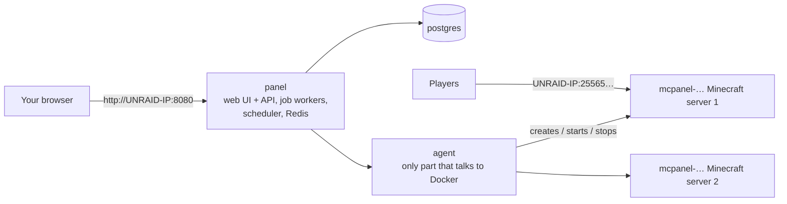

* The **Minecraft servers** use the well-known `itzg/minecraft-server` image. It downloads and
  installs modpacks itself.
* Server files live in a normal folder on your cache pool, one sub-folder per server.
* Backups are encrypted and deduplicated (restic). Btrfs pools also get instant snapshots (ZFS pools too,
  with an extra override; see docs/UNRAID.md section 6).

## 0. Before you start

You need:

* **Unraid 6.12 or newer** with Docker enabled (Settings → Docker → Enable Docker: Yes).
* A **cache pool** (SSD/NVMe) for the server files. Worlds make many small writes, and the
  parity array is slow for that.
* **RAM:** Better MC needs about **8.5 GB** while running (6 GB Java heap plus JVM overhead). Plan for
  16 GB in the box if you also run other things.
* Your Unraid server's **LAN IP address** (shown at the top right of the Unraid web UI, e.g.
  `192.168.1.10`). The examples below use `192.168.1.10`; replace it with yours everywhere.
* Internet access from Unraid (to GitHub, Docker Hub, PyPI/npm while building, and CurseForge/Mojang
  while installing packs).

## 1. Check Docker Compose

1. Open a terminal (the **`>_`** icon at the top right of the Unraid web UI) and check:

   ```bash
   docker compose version
   docker buildx version
   ```

   Both should print a version number. The second one is BuildKit, which step 5 needs to build
   the images. Run every command in this guide in that terminal.
2. Only if `docker compose` is missing: open **Apps** (Community Applications), search for
   **Compose Manager Plus** and install it; it adds the command. The older **Docker Compose
   Manager** plugin is deprecated and hidden in Community Applications by default. You only need
   the command from it: this guide starts MCPanel from the terminal, not as a stack of the
   plugin. No Compose plugin has been tested with MCPanel.

## 2. Prepare the storage

Make sure your `appdata` share stays on the cache pool: **Shares → appdata → Primary storage: your
cache pool, Secondary storage: none** (older Unraid: "Use cache pool: Only"). Otherwise the mover may
move live world files to the array.

We'll use these folders (create nothing yet, Docker creates them):

| Purpose | Path | Notes |
|---|---|---|
| Server files (worlds, mods, configs) | `/mnt/cache/appdata/mcpanel` | Replace `cache` with your pool's name if it differs (e.g. `/mnt/nvme/...`). The pool path (not `/mnt/user/...`) is faster and needed for btrfs snapshots. |
| Backups | `/mnt/user/backups/mcpanel` | On the array, so a failing SSD doesn't take your backups with it. |
| Database | `/mnt/cache/appdata/mcpanel-db` | Small. Keeps the panel's database out of `docker.img`. |

## 3. Download MCPanel

```bash
cd /mnt/user/appdata
(umask 022 && git clone -b main https://github.com/cj7s1/mcserver.git mcpanel-src)
chmod -R go-w mcpanel-src
cd mcpanel-src/deploy
```

* Root runs scripts from this folder: the upgrade, the shutdown hook at every array start and the
  daily database copy. `appdata` is usually reachable over SMB and from other containers, so only
  root may be able to change these files: `umask 022` and `chmod -R go-w` see to that (without them
  the Unraid terminal can leave every file writable by everybody). The scripts check it. The
  upgrade refuses to run otherwise and prints the same `chmod -R go-w` command; the shutdown hook
  installer and the daily database copy, which run unattended, run that command themselves, warn in
  the syslog ("permissions of ... were loose and have been tightened") and go on. Whoever can write
  to `appdata` itself could still swap the whole folder: see docs/SECURITY.md, "The source folder".
* If `git` is missing: install it with a plugin (NerdTools or un-get), or download the zip from the
  GitHub page (**Code → Download ZIP**), unpack it to `/mnt/user/appdata/mcpanel-src`, run
  `chmod -R go-w /mnt/user/appdata/mcpanel-src`, and continue.
* If the repository is **private**, GitHub asks for a username and password. Use your GitHub
  username and a **personal access token** (GitHub → Settings → Developer settings → Personal access
  tokens) as the password.

## 4. Create the settings file

```bash
./scripts/generate-secrets.sh
```

This creates `deploy/.env` with fresh random passwords and a setup token (it never overwrites an
existing file). Now edit it:

```bash
nano .env
```

Change these lines (use your IP, pool name and time zone):

```ini
# where things are stored (from step 2)
MCPANEL_DATA_DIR=/mnt/cache/appdata/mcpanel
MCPANEL_BACKUP_DIR=/mnt/user/backups/mcpanel
MCPANEL_POSTGRES_DIR=/mnt/cache/appdata/mcpanel-db

# Unraid's standard user for container files (nobody:users)
MC_UID=99
MC_GID=100

# how you will open the panel in the browser
MCPANEL_BIND=192.168.1.10
MCPANEL_PORT=8080
MCPANEL_ALLOWED_HOSTS=192.168.1.10,tower.local
MCPANEL_CSRF_TRUSTED_ORIGINS=http://192.168.1.10:8080,http://tower.local:8080

# shown in the panel as the address players connect to
MCPANEL_LAN_ADDRESS=192.168.1.10

TZ=Europe/Berlin
```

* `MCPANEL_PORT`: pick a port nothing else uses (another container may already have 8080; for example
  `8484` works too). If you change it, change it in `MCPANEL_CSRF_TRUSTED_ORIGINS` as well.
* `tower.local`: your Unraid server's name. Keep it only if you open the panel by that name.
* Leave `MCPANEL_SETUP_TOKEN` as the script wrote it. Step 6 asks for it: until the owner account
  exists, anyone who can open the panel could create it; with the token, only someone who knows it
  can. It is not needed after setup. To see it: `grep '^MCPANEL_SETUP_TOKEN=' .env`
* Save with **Ctrl+O, Enter**, quit with **Ctrl+X**.

> **Important: copy `AGENT_RESTIC_PASSWORD`** from `.env` to your password manager. Backups cannot be
> restored without it. Keep the whole `.env` file safe too, and never share it.

## 5. Start the stack

```bash
cd /mnt/user/appdata/mcpanel-src/deploy
docker compose up -d --build
```

The first run **builds** the panel and agent images. That takes 5–15 minutes depending on your CPU
and connection. Then check that everything is up:

```bash
docker compose ps
```

All three services (`postgres`, `agent`, `panel`) should show **running** and **(healthy)** after a
minute. They also appear in Unraid's **Docker** tab. The `panel` container runs the web interface,
the job workers, the scheduler and Redis; `docker compose exec panel python
/usr/local/bin/mcpanel-supervise.py status` lists them.

## 6. Create your owner account

Open **`http://192.168.1.10:8080`** in your browser. The first visit asks you to create the
**owner** account, which has full control. Enter the **setup token** (`MCPANEL_SETUP_TOKEN` from
step 4: `grep '^MCPANEL_SETUP_TOKEN=' .env` in `deploy/` shows it), then pick a username and a long
password.

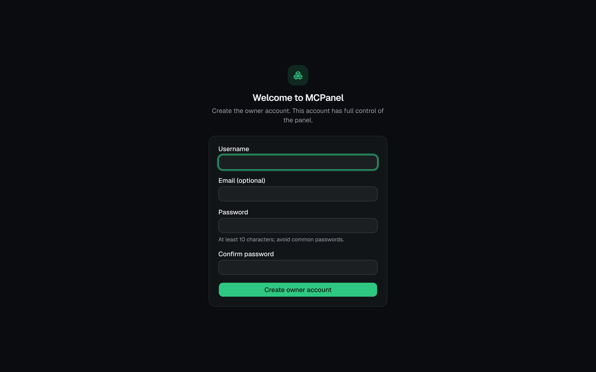

After that you land on the dashboard. It's empty until you create a server:

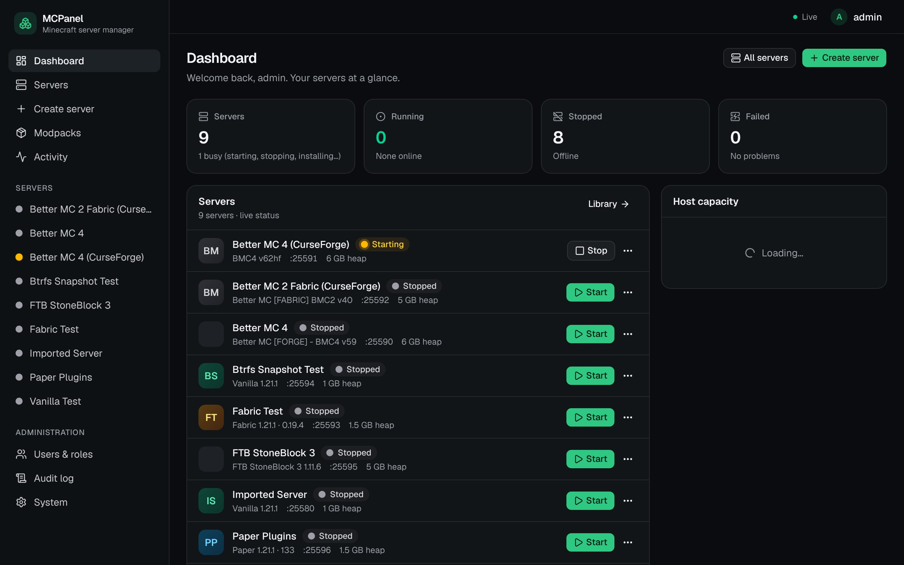

Optional, under **System** (left sidebar, Administration):

* **LAN address / public address** shows players a ready-to-copy address on every server's
  Network page.
* **CurseForge API key**: not needed for this guide. With a key you can also *search* CurseForge
  inside the panel. Without one you paste the pack's page URL, which is what we'll do.

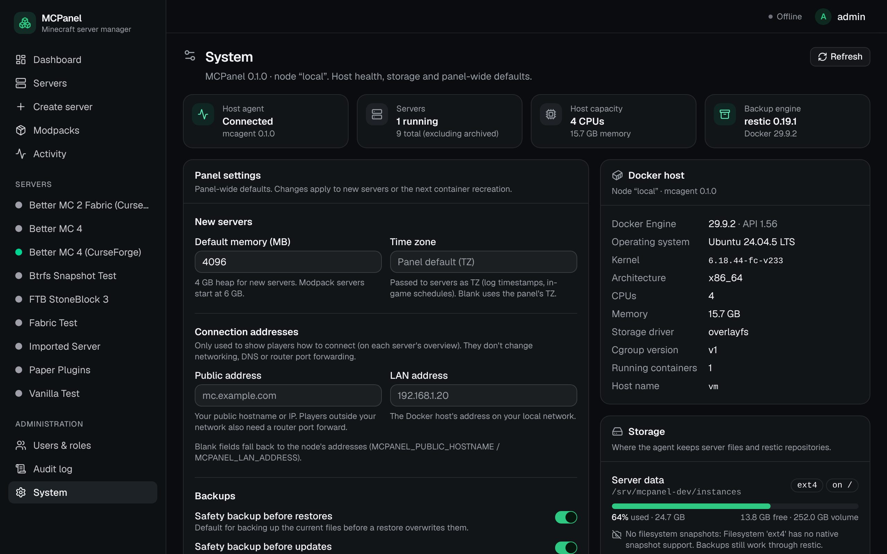

## 7. Create the Better MC server

Better MC comes in several editions. Use a **CurseForge edition**:

| Edition | Page URL | Minecraft |
|---|---|---|
| Better MC **Forge** (BMC4) | `https://www.curseforge.com/minecraft/modpacks/better-mc-forge-bmc4` | `1.20.1` |
| Better MC **Fabric** (BMC2) | `https://www.curseforge.com/minecraft/modpacks/better-mc-fabric-bmc2` | check the pack page |

> Don't use the **Modrinth** editions of Better MC: they need about 50 files that CurseForge only
> allows downloading by hand. The panel detects this and shows a list, but the CurseForge edition
> installs everything automatically.

**Step 1: Type.** Click **Create server** in the sidebar and choose **Modpack**.

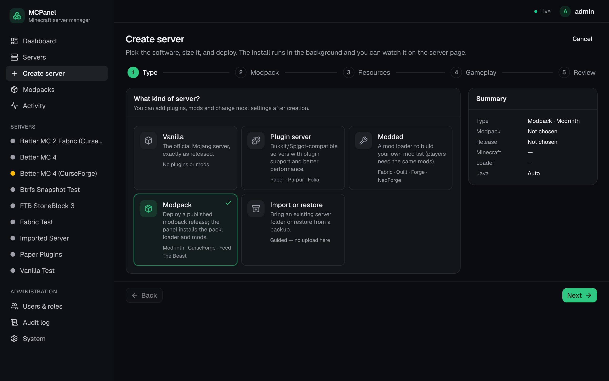

**Step 2: Modpack.** Click **CurseForge page URL**, then:

* **Modpack page URL or slug:** paste the page URL from the table above.
* **Minecraft version:** `1.20.1` (for BMC4; it is shown on the pack's CurseForge page and decides the
  Java version).
* **File id** (optional): leave it empty to get the newest server-compatible release. The panel
  pins the release that was installed, so the server doesn't change under you later.

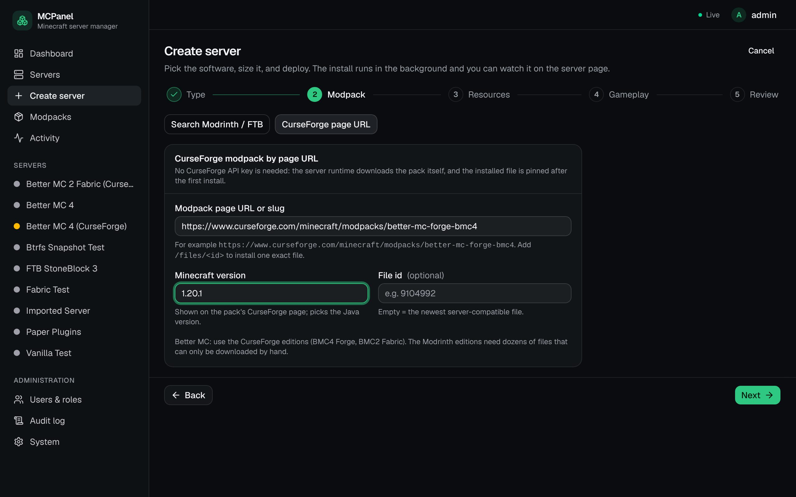

**Step 3: Resources.**

* **Server name:** filled in from the URL; change it if you like.
* **Memory (heap):** **6 GB** is right for Better MC (8 GB if you expect many players). The panel adds
  room for the JVM itself, so the *container limit* shown below the slider is what the server can
  really use. The bar below it shows how much of the host's memory the running servers already
  hold. A start that does not fit next to them (the host's RAM minus 4 GB kept free for Unraid,
  System settings) is refused with the numbers; administrators can still choose **Start anyway**.
* **Game port:** the panel suggests a free one starting at 25565. Note it down.
* **Nightly backup:** leave it switched on. It gives the server a backup schedule that runs once
  every night between 03:00 and 05:00 (panel time), also while the server is stopped. Without a
  schedule a server is only backed up when someone does it by hand.

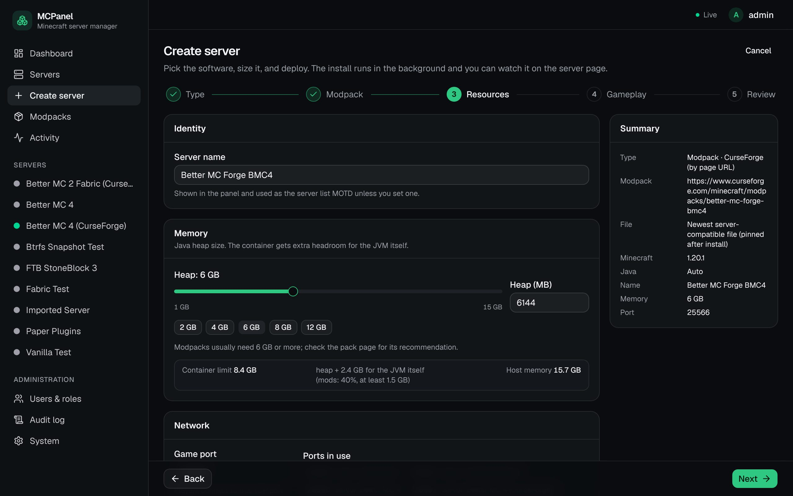

**Step 4: Gameplay.** Optional: message of the day, difficulty, game mode, max players,
whitelist. Defaults are fine for a first server. Everything here can be changed later.

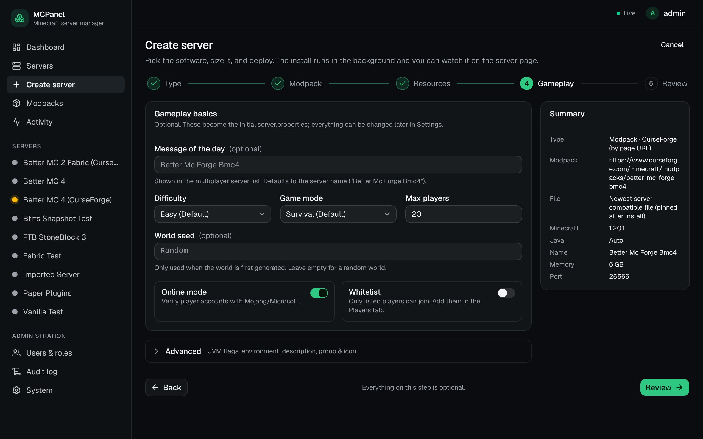

**Step 5: Review.** Check the summary, accept the **Minecraft EULA**, and click **Deploy
server**.

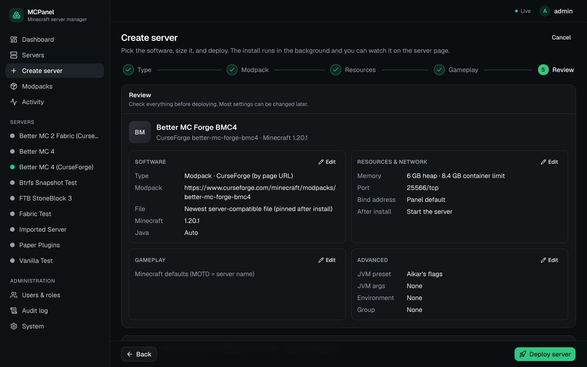

## 8. Watch it install and start

You're taken to the server page. The first start downloads the server, the mod loader and about 300
mods, which takes **3–10 minutes** depending on your connection. The status moves through **Installing →
Starting → Running**. **Running** means Minecraft actually answers its health check, not just that
the container exists.

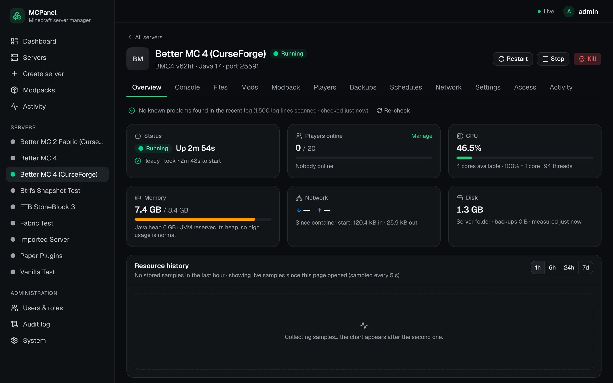

* The **Console** tab shows the live log, and you can type server commands (`list`, `op YourName`,
  `say hello`):

  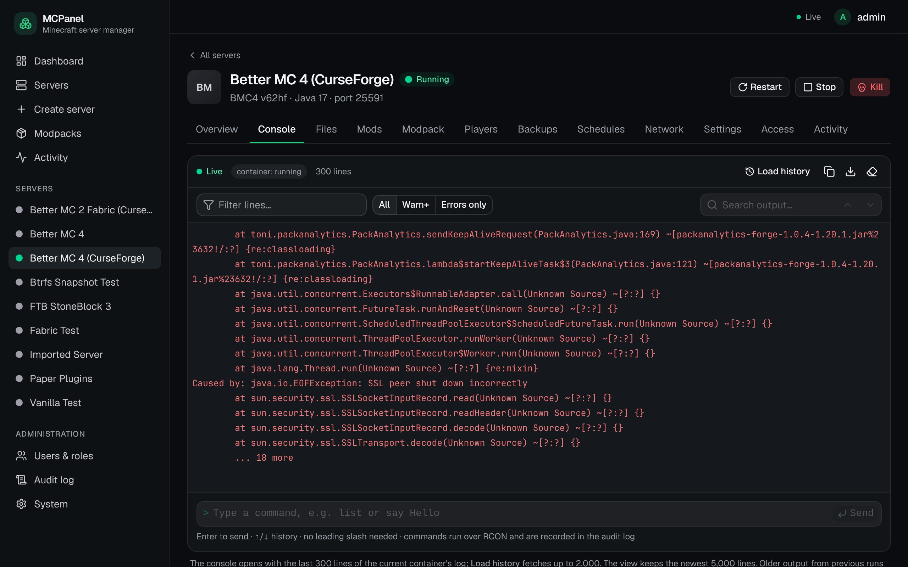

* The **Mods** tab lists every installed mod. The first time, it takes a few seconds to read ~300 files.

  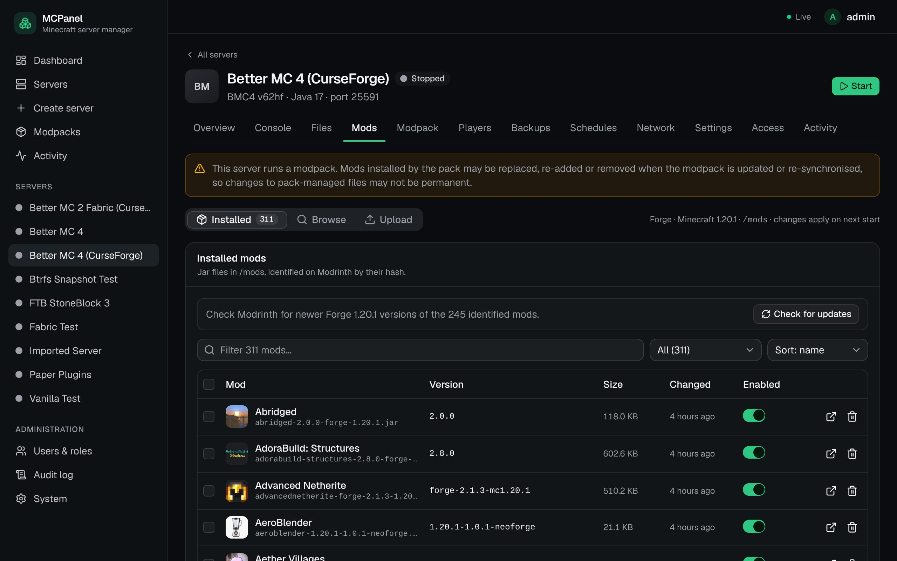

If something goes wrong, the **Overview** shows what the panel found in the log, for example a
crash loop or files the pack needs you to download yourself:

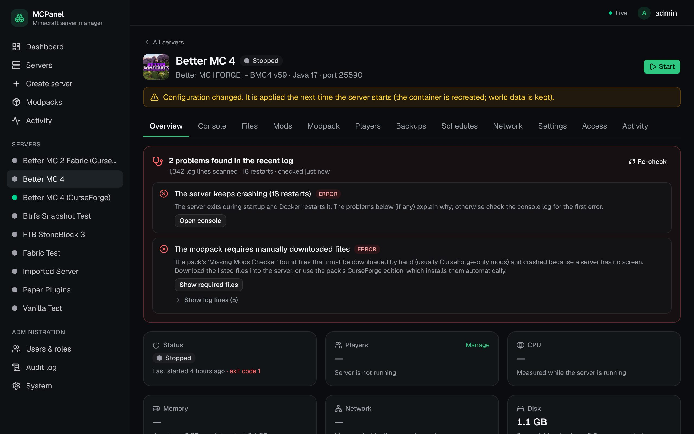

## 9. Join the server

Open the **Network** tab. It shows exactly how players reach the server:

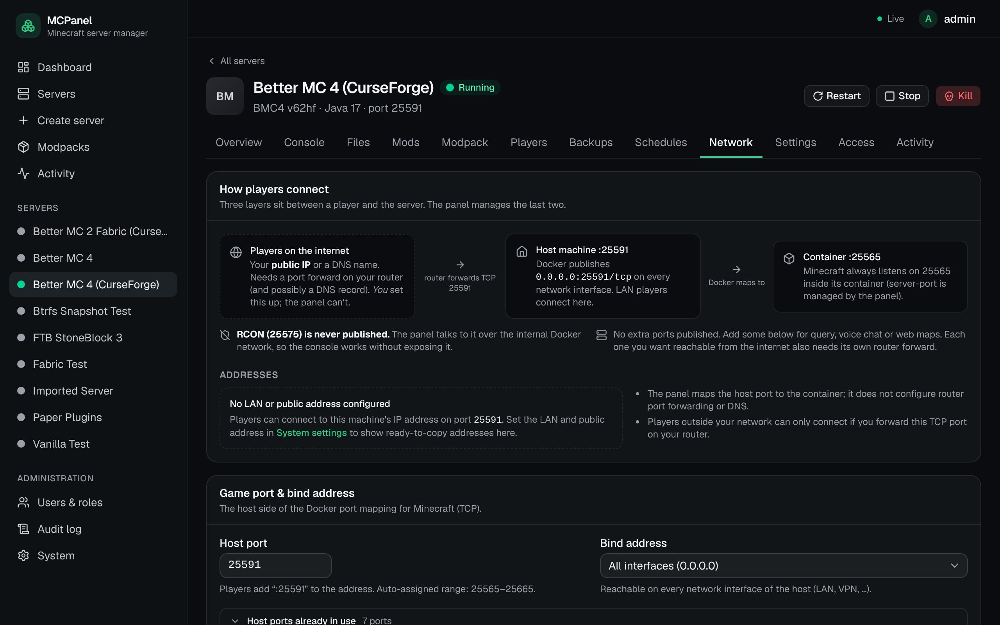

* **On your LAN:** in Minecraft (Java Edition, with the matching **Better MC client** installed
  through the CurseForge app or another launcher) choose *Multiplayer → Add Server* and enter
  `192.168.1.10:25565` (your IP and the server's port).
* **From the internet:** on your router, forward **TCP** port `25565` (the server's port) to
  `192.168.1.10`. Friends then connect to your public IP or a DNS name pointing at it. The panel never
  changes your router.
* Make yourself operator from the Console: `op YourMinecraftName`.

## 10. Protect your world: backups and schedules

Open **Backups** and click **Create backup** once to check it works. Backups are consistent even
while the server runs (the panel pauses world saving for a moment). Until a server has its first
backup, its pages and the server list show **No backup yet**; later they show **Last backup N
days ago** when the newest backup is older than 7 days.

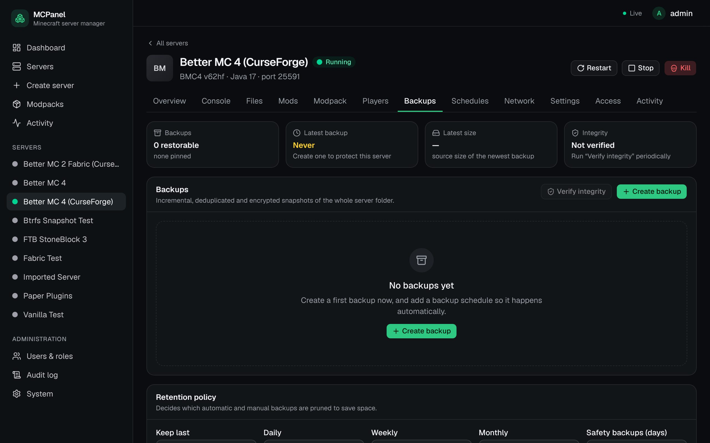

Then open **Schedules**. If you left **Nightly backup** on in the wizard, the schedule "Nightly
backup" is already there. You can add more, for example:

* **Restart** once a day (modded servers like a fresh start),
* on a btrfs pool, an hourly **Snapshot**.

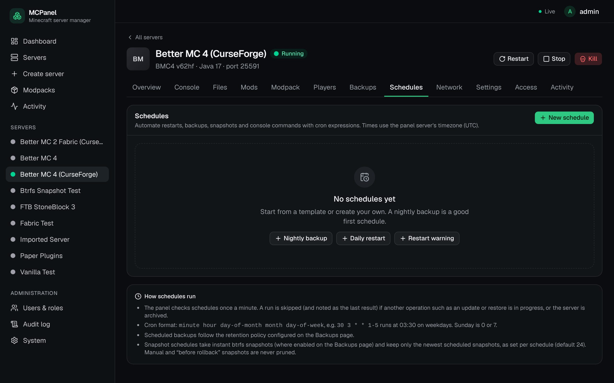

A server without a backup schedule gets one from the "Nightly backup" template on this page. To
give every server that has none a nightly backup in one go (run it in `deploy/`):

```bash
docker compose exec panel python manage.py ensure_backup_schedules --dry-run   # only lists them
docker compose exec panel python manage.py ensure_backup_schedules
```

Restoring is one click on a backup. The panel takes a safety backup of the current state first
unless you turn that off. You can also browse a backup and restore a single file or folder.

A schedule that comes due while its server is busy (for example a backup while a snapshot runs)
waits and is tried every minute for up to an hour; the list then says "Waiting". After the
server or the panel was off, a restart or stop whose time has passed is skipped ("Missed"), while
a missed backup still runs once the server is up.

**Protect the panel too.** Your worlds, the panel database and `.env` are all on the cache pool;
the backups are on the array. Set up the daily database copy with the User Scripts plugin
(DEPLOYMENT.md, "Backing up the panel itself", `deploy/unraid/backup-db.sh`) and keep
`AGENT_RESTIC_PASSWORD` in a password manager. If the cache drive dies, docs/UNRAID.md section 10
says how to get everything back.

### Starting over with a new world

To throw the world away and let the server generate a new one, open **Settings → Danger zone** and
click **Reset world…**. The dialog lists the world folders that will be deleted with their size, lets
you choose the seed (a random one, the current setting, or your own) and can carry the datapacks
over. You confirm by typing the server's name. The panel then:

1. stops the server if it is running,
2. takes a safety backup of the whole server folder and checks that the world is in it (if the backup
   fails or does not hold the world, nothing is deleted),
3. deletes the world folders,
4. starts the server again if it was running. It generates the new world while it starts.

Settings, mods, plugins, the whitelist, operators and your backups are kept. Player inventories and
positions are part of the world and go with it. Data that plugins keep outside the world folder (live
maps, land claims, homes) is not reset. To get the old world back, restore the backup named
“Before resetting the world …” (marked “Before restore”) from the **Backups** page.

Make the test backup above before your first reset: the safety backup uses the same backup storage,
and a reset with the safety backup turned off cannot be undone.

## 11. Everyday settings

**Settings** holds memory, Java version, JVM flags, server properties and software updates.
Changes that need a new container show a banner. They are applied on the next (re)start and the
world is kept.

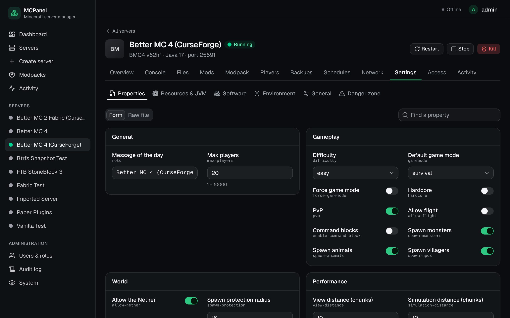

**Stop and Start.** Use the buttons in the panel. Stop first tells the server to save the world,
then stops it. 10 to 20 seconds later the server's row disappears from Unraid's Docker tab: a
stopped server has no container. Its world, settings and backups stay where they are, and the
Console page keeps the last 2,000 lines of the run. Start creates the container again. A stopped
server cannot be started from the Docker tab.

**Before you stop the array or reboot.** Without help, Unraid's Docker gives running servers at
most 20 seconds and does not tell them to save first. Install the shutdown hook once; it stops
the servers through the panel and the panel starts them again after boot:
[UNRAID-SHUTDOWN.md](UNRAID-SHUTDOWN.md). Until the hook is installed, press Stop in the panel
before you stop the array.

## 12. Updating MCPanel

```bash
cd /mnt/user/appdata/mcpanel-src && (umask 022 && git pull)
cd deploy
./scripts/upgrade.sh dry-run     # shows what will happen; changes nothing
./scripts/upgrade.sh run         # or the exact command the dry run ended with
```

After the switch everyone signs in once (since the security review a session belongs to the browser
tab that signed in). `umask 022` keeps the files `git pull` rewrites writable by root only. If group or others can
write a file of the source folder, the dry run warns and `run` refuses before it changes anything;
both print the repair, `chmod -R go-w /mnt/user/appdata/mcpanel-src` (adjust the path to yours).
A folder installed before this check needs it once.

The dry run ends with the command to use. When the new version changes the database, that
command is `./scripts/upgrade.sh run --with-migrations`, and a plain `run` refuses without
changing anything. The first upgrade from the version with seven platform containers is one of
those.

`run` refuses while a job is running (wait until **Activity** is empty), saves the database and the
current version first, downloads a newer database image, rebuilds the panel and agent on fresh base
images (`docker compose build --pull`), switches over and waits until everything is healthy. The
panel is away for under a minute. If the terminal window is closed while the images are built,
nothing was changed: run the command again. Once it has printed `==> Switching over`, a closed
window no longer stops it: it finishes on its own and keeps what it printed in
`deploy/upgrade-log-<time>.log`. `./scripts/upgrade.sh status` names that log and says whether
the update is still at work, how it ended, and what to do if it did not finish.

If the new version does not work for you, `./scripts/upgrade.sh rollback` brings the previous one
back. Two things to know about it:

* It needs the images Unraid's Docker tab lists as "(orphan image)" with names that start with
  `mcpanel-rollback/`. Do not remove those rows while you may want to go back.
* Afterwards the source folder is on the old version, and `deploy/scripts/upgrade.sh` may be gone
  from disk because the old version did not have it. `git checkout <your branch>` brings it back.
  From then on the folder holds the new version while the old one runs: do not type
  `docker compose up -d` there, only `./scripts/upgrade.sh ...` (`status` shows which version
  runs; `run` updates again).

More about every step: [DEPLOYMENT.md](../DEPLOYMENT.md), "Upgrading".

Running Minecraft servers are not restarted by a panel update. `run` already saves the panel
database into `deploy/`; to take a copy at any other time (run it in `deploy/`):

```bash
(umask 077 && mkdir -p /mnt/user/appdata/mcpanel-db-backups && \
 docker compose exec -T postgres pg_dump -U mcpanel --exclude-table-data=django_session mcpanel \
   > /mnt/user/appdata/mcpanel-db-backups/mcpanel-db-$(date +%F).sql)
```

The dump contains your users' password hashes and the panel's encrypted secrets, so it is only
readable by root (`umask 077`) and kept out of shared folders: check under **Shares → appdata** that
the share is not exported over SMB/NFS, or use another folder that isn't. Login sessions are left out
(`--exclude-table-data=django_session`): with them, whoever has the file could use the panel as a
logged-in user.

---

## Troubleshooting

| Symptom | Fix |
|---|---|
| Browser can't open the panel | `docker compose ps`: is `panel` running? Is `MCPANEL_BIND` your Unraid IP and the port free? After editing `.env`, run `docker compose up -d` again. |
| "Bad Request (400)" | The address in your browser isn't in `MCPANEL_ALLOWED_HOSTS`. Add it and run `docker compose up -d`. |
| Login or forms fail with a CSRF error | Add the exact address (with `http://` and the port) to `MCPANEL_CSRF_TRUSTED_ORIGINS`, then `docker compose up -d`. |
| `MCPANEL_SECRET_KEY is not set` when starting | You ran `docker compose` outside `deploy/`, or `.env` is missing: run `./scripts/generate-secrets.sh` in `deploy/`. |
| Server stays **Installing** a long time | Open **Console**: the pack is still downloading. Large packs take several minutes. |
| Server **keeps crashing** / **Failed** | The Overview lists the cause it found. Common: too little memory (raise it in Settings), wrong Java (set it in Settings), or the Modrinth edition of Better MC (use the CurseForge edition). The panel stops a server that crashes 5 times in a row so it doesn't loop forever. |
| "Permission denied" in server files | Check `MC_UID=99` / `MC_GID=100` in `.env`, then restart the server. |
| Lag spikes when the world saves | Make sure `MCPANEL_DATA_DIR` is on the cache pool (`/mnt/cache/...`), not the array. |
| Friends outside can't join | The router port forward is missing or points at the wrong IP or port. LAN players connecting is the test that the server itself works. |
| Unraid's Docker tab says "update available" for `mcpanel-…` | Ignore it. The panel manages those containers; change their runtime in the panel instead. **Don't edit or start `mcpanel-…` containers from the Docker tab.** |
| Panel or agent logs | `docker compose logs --tail 100 panel` (or `agent`). Every panel line starts with the part that wrote it: `[web]`, `[worker]`, `[periodic]`, `[beat]`, `[redis]`. They never contain passwords. |
| `panel` shows **unhealthy** | `docker compose exec panel python /usr/local/bin/mcpanel-supervise.py status` shows which part is not running; `docker compose logs --tail 100 panel` shows why. |
| You stopped or restarted `panel` in the Docker tab and a job failed | The Docker tab gives 10 seconds. With jobs running use `docker compose restart panel` in `deploy/` (up to 110 seconds for jobs to finish). A job that was waiting for the agent is marked as failed at once; one cut off in other work keeps its server locked for about 6 minutes, and **Mark as failed** on the Activity page releases it sooner. The `panel` row comes back by itself at the next start of Docker (reboot, array start). |
| A stopped server is missing in Unraid's Docker tab | Expected: a stopped server has no container. Start it in the panel. |
| A server shows "restart required" after you updated MCPanel | Its container was made by the older version. Restart it when it suits you; the world is kept. |
| A server shows **No backup yet** | Create one on its Backups page and check that it has a backup schedule (section 10). |
| Servers did not start after a reboot | See [UNRAID-SHUTDOWN.md](UNRAID-SHUTDOWN.md), "How the servers come back". |
| A start says "Not enough memory" | The running servers plus this one need more than the host's RAM minus the reserve. Stop another server, lower the memory, or (administrators only) press **Start anyway**. |
| You typed `stop` in the console | The panel stops the server the way the Stop button does (typed straight into the server, Docker would only restart it). |
| A text file opens read-only | It is not UTF-8 text; saving it from the panel would damage it. Use **Download** and edit it on your computer. |

More detail: [docs/UNRAID.md](UNRAID.md) (the Docker tab, orphan images, snapshots on btrfs and ZFS
pools), [UNRAID-SHUTDOWN.md](UNRAID-SHUTDOWN.md) (array stop, reboot, shutdown),
[DEPLOYMENT.md](../DEPLOYMENT.md) (upgrades, HTTPS behind a reverse proxy, more Docker hosts),
[docs/SECURITY.md](SECURITY.md) (what is and isn't isolated; only install mods you trust).
