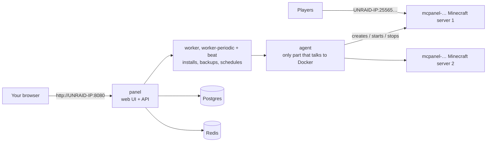

# Quickstart: MCPanel on Unraid + your first modded server

This guide takes you from a fresh Unraid box to a running **Better Minecraft (Better MC)** modpack
server that your friends can join. Budget about 30–45 minutes, most of it waiting for downloads.

> **About the screenshots.** They come from a real MCPanel install on a test machine, so the sidebar
> lists that machine's test servers. Your panel starts empty. Unraid's own screens aren't shown;
> those steps are described in text.
>
> **Status:** MCPanel works on Linux Docker hosts, and every step below was tested there, but this
> is the first run on real Unraid hardware. If something on Unraid behaves differently, note
> what you saw (Troubleshooting is at the end).

---

## What you are installing

MCPanel is a small stack of containers. You start it once with Docker Compose. After that, the
panel creates one extra container per Minecraft server for you.



* The **Minecraft servers** use the well-known `itzg/minecraft-server` image. It downloads and
  installs modpacks itself.
* Server files live in a normal folder on your cache pool, one sub-folder per server.
* Backups are encrypted and deduplicated (restic). Btrfs pools also get instant snapshots (ZFS pools too,
  with an extra override; see docs/UNRAID.md section 6).

## 0. Before you start

You need:

* **Unraid 6.12 or newer** with Docker enabled (Settings → Docker → Enable Docker: Yes).
* A **cache pool** (SSD/NVMe) for the server files. Worlds make many small writes, and the
  parity array is slow for that.
* **RAM:** Better MC needs about **8.5 GB** while running (6 GB Java heap plus JVM overhead). Plan for
  16 GB in the box if you also run other things.
* Your Unraid server's **LAN IP address** (shown at the top right of the Unraid web UI, e.g.
  `192.168.1.10`). The examples below use `192.168.1.10`; replace it with yours everywhere.
* Internet access from Unraid (to GitHub, Docker Hub, PyPI/npm while building, and CurseForge/Mojang
  while installing packs).

## 1. Install Docker Compose

1. In the Unraid web UI open **Apps** (Community Applications).
2. Search for **Docker Compose Manager** and install it. It adds the `docker compose` command.
3. Open a terminal (the **`>_`** icon at the top right of the Unraid web UI) and check:

   ```bash
   docker compose version
   ```

   It should print a version number. Run every command in this guide in that terminal.

## 2. Prepare the storage

Make sure your `appdata` share stays on the cache pool: **Shares → appdata → Primary storage: your
cache pool, Secondary storage: none** (older Unraid: "Use cache pool: Only"). Otherwise the mover may
move live world files to the array.

We'll use these folders (create nothing yet, Docker creates them):

| Purpose | Path | Notes |
|---|---|---|
| Server files (worlds, mods, configs) | `/mnt/cache/appdata/mcpanel` | Replace `cache` with your pool's name if it differs (e.g. `/mnt/nvme/...`). The pool path (not `/mnt/user/...`) is faster and needed for btrfs snapshots. |
| Backups | `/mnt/user/backups/mcpanel` | On the array, so a failing SSD doesn't take your backups with it. |
| Database | `/mnt/cache/appdata/mcpanel-db` | Small. Keeps the panel's database out of `docker.img`. |

## 3. Download MCPanel

```bash
cd /mnt/user/appdata
git clone -b main https://github.com/cj7s1/mcserver.git mcpanel-src
cd mcpanel-src/deploy
```

* If `git` is missing: install it with a plugin (NerdTools or un-get), or download the zip from the
  GitHub page (**Code → Download ZIP**), unpack it to `/mnt/user/appdata/mcpanel-src`, and continue.
* If the repository is **private**, GitHub asks for a username and password. Use your GitHub
  username and a **personal access token** (GitHub → Settings → Developer settings → Personal access
  tokens) as the password.

## 4. Create the settings file

```bash
./scripts/generate-secrets.sh
```

This creates `deploy/.env` with fresh random passwords (it never overwrites an existing file). Now
edit it:

```bash
nano .env
```

Change these lines (use your IP, pool name and time zone):

```ini
# where things are stored (from step 2)
MCPANEL_DATA_DIR=/mnt/cache/appdata/mcpanel
MCPANEL_BACKUP_DIR=/mnt/user/backups/mcpanel
MCPANEL_POSTGRES_DIR=/mnt/cache/appdata/mcpanel-db

# Unraid's standard user for container files (nobody:users)
MC_UID=99
MC_GID=100

# how you will open the panel in the browser
MCPANEL_BIND=192.168.1.10
MCPANEL_PORT=8080
MCPANEL_ALLOWED_HOSTS=192.168.1.10,tower.local
MCPANEL_CSRF_TRUSTED_ORIGINS=http://192.168.1.10:8080,http://tower.local:8080

# shown in the panel as the address players connect to
MCPANEL_LAN_ADDRESS=192.168.1.10

# asked for when you create the owner account in step 6 (see below)
MCPANEL_SETUP_TOKEN=REPLACE-with-the-output-of-openssl-rand-hex-24

TZ=Europe/Berlin
```

* `MCPANEL_PORT`: pick a port nothing else uses (another container may already have 8080; for example
  `8484` works too). If you change it, change it in `MCPANEL_CSRF_TRUSTED_ORIGINS` as well.
* `tower.local`: your Unraid server's name. Keep it only if you open the panel by that name.
* `MCPANEL_SETUP_TOKEN`: a random value of your own: run `openssl rand -hex 24` and paste its output
  after the `=`. Until the owner account exists, anyone who can open the panel could create
  it; with a token, only someone who knows it can. It is not needed after setup.
* Save with **Ctrl+O, Enter**, quit with **Ctrl+X**.

> **Important: copy `AGENT_RESTIC_PASSWORD`** from `.env` to your password manager. Backups cannot be
> restored without it. Keep the whole `.env` file safe too, and never share it.

## 5. Start the stack

```bash
cd /mnt/user/appdata/mcpanel-src/deploy
docker compose up -d --build
```

The first run **builds** the panel and agent images. That takes 5–15 minutes depending on your CPU
and connection. Then check that everything is up:

```bash
docker compose ps
```

All seven services (`postgres`, `redis`, `agent`, `panel`, `worker`, `worker-periodic`, `beat`) should
show **running**, and `panel` and `agent` should show **(healthy)** after a minute. They also appear in Unraid's
**Docker** tab.

## 6. Create your owner account

Open **`http://192.168.1.10:8080`** in your browser. The first visit asks you to create the
**owner** account, which has full control. Enter the **setup token** (`MCPANEL_SETUP_TOKEN` from
step 4), then pick a username and a long password.


After that you land on the dashboard. It's empty until you create a server:


Optional, under **System** (left sidebar, Administration):

* **LAN address / public address** shows players a ready-to-copy address on every server's
  Network page.
* **CurseForge API key**: not needed for this guide. With a key you can also *search* CurseForge
  inside the panel. Without one you paste the pack's page URL, which is what we'll do.


## 7. Create the Better MC server

Better MC comes in several editions. Use a **CurseForge edition**:

| Edition | Page URL | Minecraft |
|---|---|---|
| Better MC **Forge** (BMC4) | `https://www.curseforge.com/minecraft/modpacks/better-mc-forge-bmc4` | `1.20.1` |
| Better MC **Fabric** (BMC2) | `https://www.curseforge.com/minecraft/modpacks/better-mc-fabric-bmc2` | check the pack page |

> Don't use the **Modrinth** editions of Better MC: they need about 50 files that CurseForge only
> allows downloading by hand. The panel detects this and shows a list, but the CurseForge edition
> installs everything automatically.

**Step 1: Type.** Click **Create server** in the sidebar and choose **Modpack**.


**Step 2: Modpack.** Click **CurseForge page URL**, then:

* **Modpack page URL or slug:** paste the page URL from the table above.
* **Minecraft version:** `1.20.1` (for BMC4; it is shown on the pack's CurseForge page and decides the
  Java version).
* **File id** (optional): leave it empty to get the newest server-compatible release. The panel
  pins the release that was installed, so the server doesn't change under you later.


**Step 3: Resources.**

* **Server name:** filled in from the URL; change it if you like.
* **Memory (heap):** **6 GB** is right for Better MC (8 GB if you expect many players). The panel adds
  room for the JVM itself, so the *container limit* shown below the slider is what the server can
  really use. Make sure it fits in your free RAM.
* **Game port:** the panel suggests a free one starting at 25565. Note it down.


**Step 4: Gameplay.** Optional: message of the day, difficulty, game mode, max players,
whitelist. Defaults are fine for a first server. Everything here can be changed later.


**Step 5: Review.** Check the summary, accept the **Minecraft EULA**, and click **Deploy
server**.


## 8. Watch it install and start

You're taken to the server page. The first start downloads the server, the mod loader and about 300
mods, which takes **3–10 minutes** depending on your connection. The status moves through **Installing →
Starting → Running**. **Running** means Minecraft actually answers its health check, not just that
the container exists.


* The **Console** tab shows the live log, and you can type server commands (`list`, `op YourName`,
  `say hello`):

  

* The **Mods** tab lists every installed mod. The first time, it takes a few seconds to read ~300 files.

  

If something goes wrong, the **Overview** shows what the panel found in the log, for example a
crash loop or files the pack needs you to download yourself:


## 9. Join the server

Open the **Network** tab. It shows exactly how players reach the server:


* **On your LAN:** in Minecraft (Java Edition, with the matching **Better MC client** installed
  through the CurseForge app or another launcher) choose *Multiplayer → Add Server* and enter
  `192.168.1.10:25565` (your IP and the server's port).
* **From the internet:** on your router, forward **TCP** port `25565` (the server's port) to
  `192.168.1.10`. Friends then connect to your public IP or a DNS name pointing at it. The panel never
  changes your router.
* Make yourself operator from the Console: `op YourMinecraftName`.

## 10. Protect your world: backups and schedules

Open **Backups** and click **Create backup** once to check it works. Backups are consistent even
while the server runs (the panel pauses world saving for a moment).


Then open **Schedules** and add, for example:

* **Backup** every night at 04:00,
* **Restart** once a day (modded servers like a fresh start),
* on a btrfs pool, an hourly **Snapshot**.


Restoring is one click on a backup. The panel takes a safety backup of the current state first
unless you turn that off. You can also browse a backup and restore a single file or folder.

## 11. Everyday settings

**Settings** holds memory, Java version, JVM flags, server properties and software updates.
Changes that need a new container show a banner. They are applied on the next (re)start and the
world is kept.


## 12. Updating MCPanel

```bash
cd /mnt/user/appdata/mcpanel-src && git pull
cd deploy
docker compose pull --ignore-buildable   # newer database and Redis images
docker compose build --pull              # rebuild the panel and agent on fresh base images
docker compose up -d
```

Running Minecraft servers are not restarted by a panel update. Before big updates you can back up
the panel database (run it in `deploy/`):

```bash
(umask 077 && mkdir -p /mnt/user/appdata/mcpanel-db-backups && \
 docker compose exec -T postgres pg_dump -U mcpanel --exclude-table-data=django_session mcpanel \
   > /mnt/user/appdata/mcpanel-db-backups/mcpanel-db-$(date +%F).sql)
```

The dump contains your users' password hashes and the panel's encrypted secrets, so it is only
readable by root (`umask 077`) and kept out of shared folders: check under **Shares → appdata** that
the share is not exported over SMB/NFS, or use another folder that isn't. Login sessions are left out
(`--exclude-table-data=django_session`): with them, whoever has the file could use the panel as a
logged-in user.

---

## Troubleshooting

| Symptom | Fix |
|---|---|
| Browser can't open the panel | `docker compose ps`: is `panel` running? Is `MCPANEL_BIND` your Unraid IP and the port free? After editing `.env`, run `docker compose up -d` again. |
| "Bad Request (400)" | The address in your browser isn't in `MCPANEL_ALLOWED_HOSTS`. Add it and run `docker compose up -d`. |
| Login or forms fail with a CSRF error | Add the exact address (with `http://` and the port) to `MCPANEL_CSRF_TRUSTED_ORIGINS`, then `docker compose up -d`. |
| `MCPANEL_SECRET_KEY is not set` when starting | You ran `docker compose` outside `deploy/`, or `.env` is missing: run `./scripts/generate-secrets.sh` in `deploy/`. |
| Server stays **Installing** a long time | Open **Console**: the pack is still downloading. Large packs take several minutes. |
| Server **keeps crashing** / **Failed** | The Overview lists the cause it found. Common: too little memory (raise it in Settings), wrong Java (set it in Settings), or the Modrinth edition of Better MC (use the CurseForge edition). The panel stops a server that crashes 5 times in a row so it doesn't loop forever. |
| "Permission denied" in server files | Check `MC_UID=99` / `MC_GID=100` in `.env`, then restart the server. |
| Lag spikes when the world saves | Make sure `MCPANEL_DATA_DIR` is on the cache pool (`/mnt/cache/...`), not the array. |
| Friends outside can't join | The router port forward is missing or points at the wrong IP or port. LAN players connecting is the test that the server itself works. |
| Unraid's Docker tab says "update available" for `mcpanel-…` | Ignore it. The panel manages those containers; change their runtime in the panel instead. **Don't edit or start `mcpanel-…` containers from the Docker tab.** |
| Panel or agent logs | `docker compose logs --tail 100 panel` (or `agent`, `worker`). They never contain passwords. |

More detail: [docs/UNRAID.md](UNRAID.md) (snapshots on btrfs and ZFS pools, extra capabilities),
[DEPLOYMENT.md](../DEPLOYMENT.md) (HTTPS behind a reverse proxy, more Docker hosts),
[docs/SECURITY.md](SECURITY.md) (what is and isn't isolated; only install mods you trust).
